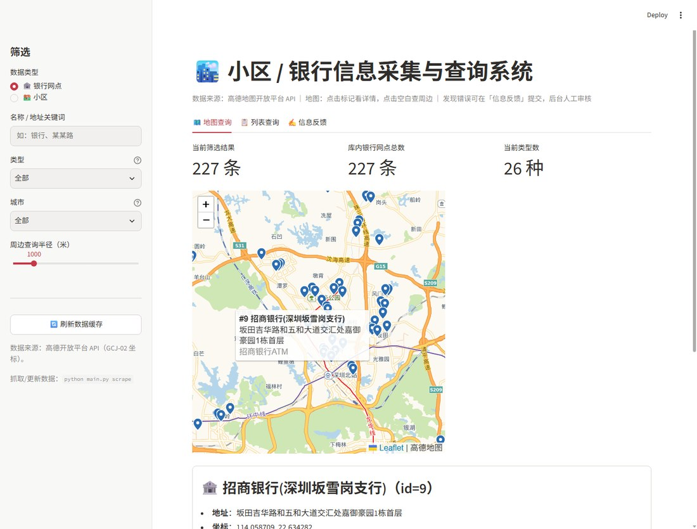
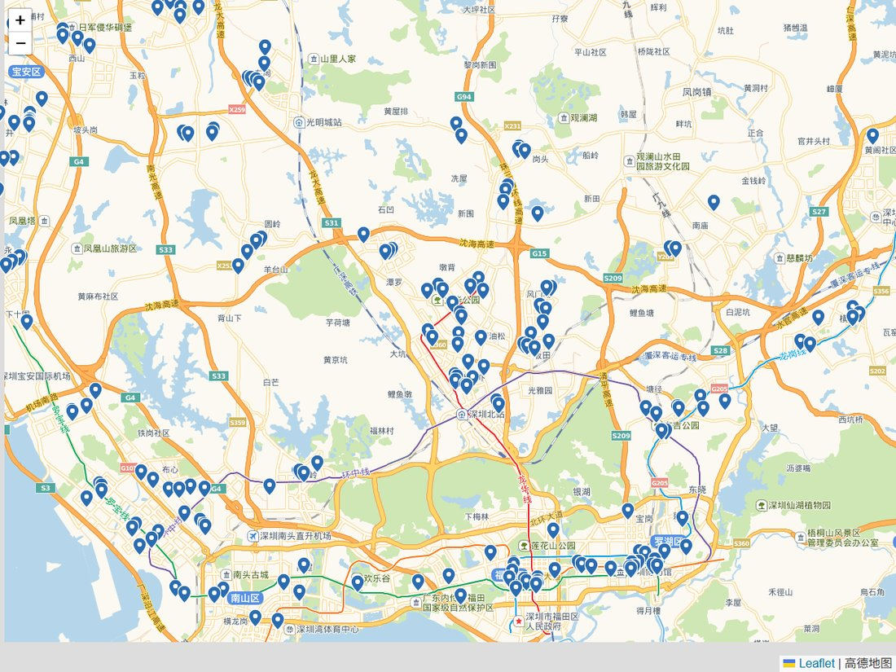

# 小区 / 银行信息采集与查询系统

一个基于 **高德开放平台 API + SQLite + Streamlit** 的演示项目：采集「银行网点」与「小区」两类 POI 数据，
提供**地图式**与**列表式**两种查询方式，并支持用户在前端**反馈信息错误**、经后台人工审核后回写修正。

> 完整的小型业务闭环：**采集 → 存储 → 查询 → 反馈 → 审核修正**。
> 项目定位是初版 demo，重点在跑通闭环，同时为「换城市、加数据类别、数据量变大、换数据库」留好接口。



## 功能

| 模块 | 说明 |
|---|---|
| 🗺️ 地图查询 | 银行 / 小区双图层打点；点击标记看详情，点击空白查周边（半径 200–5000 米可调） |
| 📋 列表查询 | 关键词（名称+地址）、类型、城市筛选；排序、升降序、分页、导出当前页 CSV |
| ✍️ 信息反馈 | 详情卡片内嵌表单 + 独立反馈页；写入 `feed_back` 表，状态「待审核」 |
| ✅ 人工审核 | 命令行 `review list / show / approve / reject`，通过时可按建议值回写，全程留痕 |
| ⬇️ 数据抓取 | 高德 v5 文本检索，可换城市、改关键词、限页数；UPSERT 天然去重 |
| 🧾 静态导出 | 一键导出可离线双击打开的 HTML 地图 |

静态导出的效果（不依赖任何外网 CDN，双击即开）：



## 工程约束（这个 demo 想说明的事）

- **权责分明**：全项目只有 `SQLOperation.py` 直接操作数据库（只有它 `import sqlite3`、只有它写 SQL），
  前端与抓取脚本一律调它的接口——以后换 PostgreSQL，只改这一个文件。
- **不写死**：数据库路径、城市、分页、节流、重试、地图资源全部集中在 `config.py`，可用环境变量覆盖；
  新增一类数据只需在 `LAYERS` 里加一条。
- **离线可用**：Leaflet 本地化（`libs/`），不走公网 CDN；标记点是内联 SVG 图钉，零图标库依赖。
- **可扩展**：`extra` JSON 列预留未来业务字段；分页、索引、地图渲染上限都为大数据量留了口子。

## 技术栈

Python 3.10+ · Streamlit · Folium / Leaflet 1.9.4 · SQLite · requests · pandas · python-dotenv

## 快速开始

```bash
git clone <你的仓库地址>
cd <仓库目录>

python -m venv .venv
.venv\Scripts\activate          # Windows
# source .venv/bin/activate     # macOS / Linux
pip install -r requirements.txt

# 配置高德 Key（没有 Key 也能打开界面看示例数据，但抓取/底图需要它）
copy .env.example .env          # Windows；macOS/Linux 用 cp
#   然后编辑 .env：AMAP_KEY=你的Key

python main.py db migrate       # 建表 / 升级结构（幂等）
python main.py scrape --target all --city 深圳 --pages 5
python main.py app              # 浏览器打开 http://localhost:8501
```

## 目录结构

| 文件 | 职责 |
|---|---|
| `main.py` | **统一入口**：`app` / `scrape` / `export-map` / `db` / `review` |
| `config.py` | 全局配置 + 数据图层注册表（`LAYERS`） |
| `SQLOperation.py` | **唯一数据访问层**：建表迁移、查询、UPSERT、反馈、审核回写 |
| `DataGet.py` | 高德 POI 抓取 → 清洗 → 入库 |
| `bank_map_app.py` | Streamlit 前端：地图 / 列表 / 反馈 |
| `folium_map.py` | 静态地图导出 |
| `map_assets.py` | 地图资源本地化（Leaflet 本地引用 + 内联图钉） |
| `banks.db` | SQLite 数据库（结构 v3，含示例数据） |
| `libs/` | Leaflet 1.9.4 本地副本（离线用） |
| `docs/` | 开发记录与截图 |

## 数据库（v3）

- `banks` / `communities`：`id, name, address, lng, lat, tel, type, city, district, adcode, source, extra, created_at, updated_at`
  唯一索引 `(name, lng, lat)` 负责去重；`lng/lat` 为 **GCJ-02**（高德火星坐标）
- `feed_back`：`id, target_type, target_id, target_name, field_name, error_desc, suggested_value, contact, status, reviewer, review_note, created_at, reviewed_at`

## 反馈 → 审核流程

```bash
python main.py review list                                    # 待审核列表
python main.py review show 3                                  # 看详情
python main.py review approve 3 --apply --reviewer 张三 --note 电话核实   # 通过并可回写
python main.py review reject 3 --note 证据不足                 # 驳回
```

回写只改用户指明的那个字段，且与状态变更在同一事务里；`--apply` 在非交互环境需加 `--yes`。

## 配置项（环境变量 / `.env`）

| 变量 | 默认值 | 说明 |
|---|---|---|
| `AMAP_KEY` | 无 | 高德 Web 服务 Key，抓取数据必需 |
| `BANKS_DB` | `banks.db` | 数据库文件路径 |
| `DEFAULT_CITY` | `深圳` | 默认抓取城市 |
| `MAP_ASSET_MODE` | `inline` | 地图资源模式，设为 `cdn` 可回退公网 CDN |
| `LEAFLET_DIR` | `libs` | 本地 Leaflet 目录 |

## 扩展点

- **新增数据类别**（学校、医院、加油站…）：在 `config.LAYERS` 加一条，前端图层、抓取、列表、反馈全部自动支持
- **换城市 / 多城市共存**：`--city 广州`，数据按 `city` 列区分，城市下拉框自动出现新城市
- **换数据库**：只改 `SQLOperation.py`
- **数据量变大**：分页 + SQL 侧 bounding box + 索引；地图渲染上限见 `MAP_MARKER_LIMIT`

## 注意事项

- **API Key 不入库**：`.env` 已在 `.gitignore` 中，仓库里只有 `.env.example`
- **数据版权**：POI 数据来自高德开放平台，仅用于学习与演示，请遵守其服务条款
- **坐标系**：数据是 GCJ-02，底图必须用高德瓦片；换成 WGS84 底图（如 OpenStreetMap）会整体偏移约 500 米
- **底图仍需联网**：瓦片来自高德服务器，完全断网时只能看到标记点与控件

## 已知限制

- 单机 SQLite，未针对多用户并发写入优化
- 审核为命令行工具，没有账号体系与网页后台
- 高德文本检索单关键词最多 100 页，城市数据量大时需按区县拆分检索

## 开发记录

改造思路、原代码「可改进」批注的处理、地图加载踩坑与验证方法见
[docs/开发记录.md](docs/开发记录.md)。
